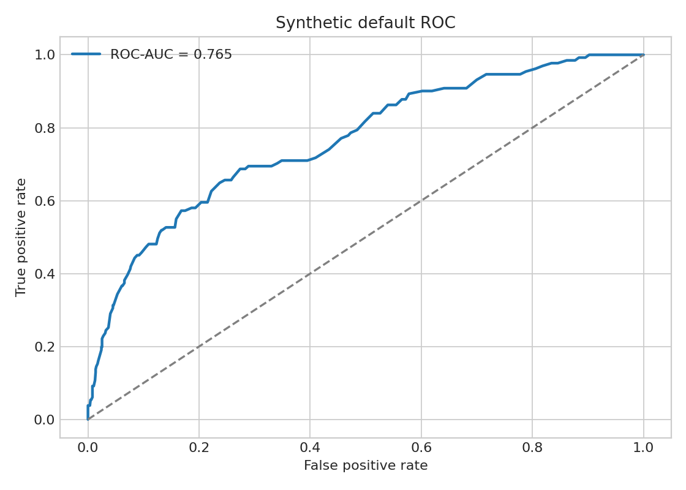
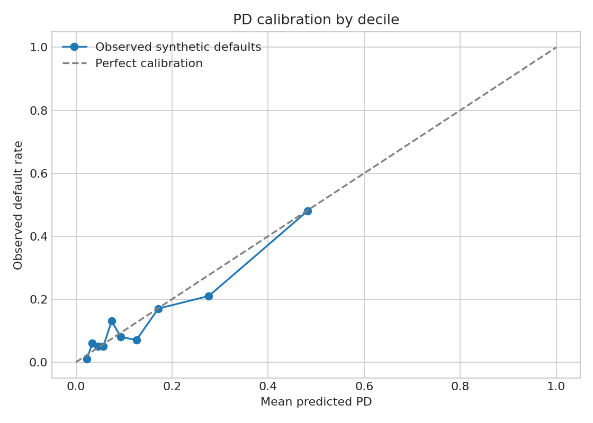
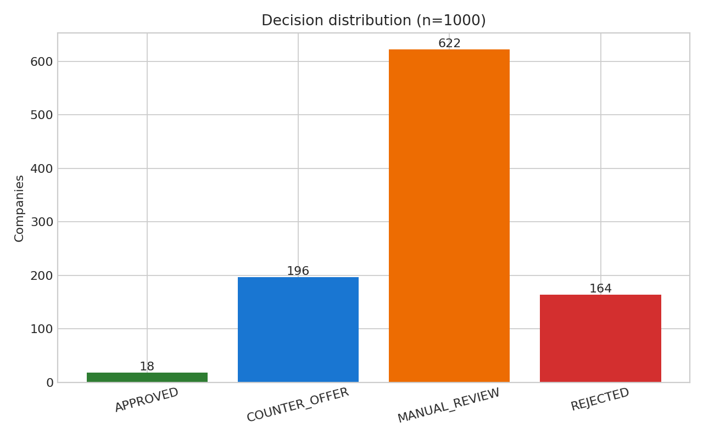
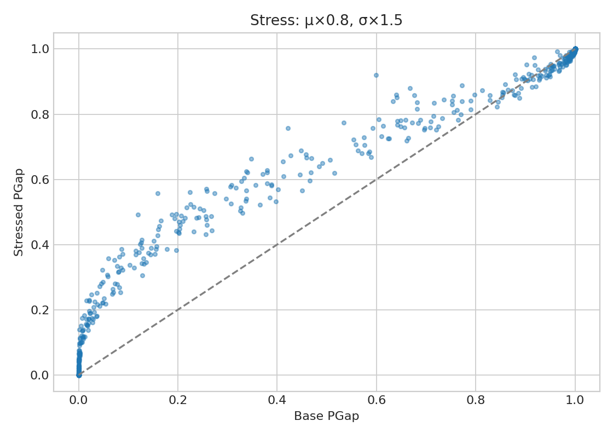

# Умный кредит

Демонстрационный сервис кредитования малого бизнеса: Go API собирает сведения из mock-интеграций, рассчитывает PD и риск кассового разрыва, маршрутизирует заявку и формирует предложения. FastAPI предоставляет детерминированные данные и LLM-объяснения с rule-based fallback, PostgreSQL хранит заявки, React-интерфейс ведёт клиента от входа до решения.

## Быстрый старт

```bash
cp .env.example .env
docker compose up --build
```

- веб-интерфейс: http://localhost:3000
- Go API: http://localhost:8080/api/v1
- health/readiness: `/health`, `/ready`

Compose запускает PostgreSQL 16 с persistent volume, применяет миграции отдельным one-shot контейнером и только затем поднимает backend и frontend. Реальные секреты в `.env` не коммитятся.

## Архитектура

```text
Browser :3000 -> nginx/frontend -> Go API :8080 -> PostgreSQL 16
                                      |
                                      +-> FastAPI ml-mock :8081
                                          |-- ЕГРЮЛ/ЕГРИП, ФНС, БКИ, АБС mocks
                                          `-- Ollama/OpenAI-compatible LLM -> rules fallback
```

Backend сохраняет clean-architecture границы: HTTP adapters → use cases → domain/ports → PostgreSQL и ML adapters. Frontend обращается только к Go API.

## Демо-доступ

Пароль всех учётных записей — `demo`.

| Логин | Сценарий |
|---|---|
| `client1` | автоодобрение / контрпредложение при большой сумме |
| `client2` | контрпредложение POINT_A и POINT_B |
| `client3` | ручной разбор |
| `client4` | высокий PD, отказ |
| `client5` | стоп-фактор ликвидации |
| `client6` | недоступная ФНС, fallback на ручную проверку |
| `client7`…`client10` | дополнительные golden-персоны |
| `inspector1` | Елена Волкова, андеррайтер (`INSPECTOR`) |

На чистой базе очередь инспектора сразу содержит демонстрационные заявки `Z-152`…`Z-156`.

## Модель риска

Актуальный контракт модели v1 зафиксирован в [docs/model_contract.md](docs/model_contract.md). Scorecard использует параметры BaseScore=600, BaseOdds=50 и PDO=20; PD вычисляется через odds. Равновесная ставка учитывает LGD, платёж — аннуитетный. Вероятность кассового разрыва:

```text
PGap = Φ((debt_old + payment - μ - C₀/n) / σ)
```

где `C₀` — денежная подушка, распределённая на срок `n`. Пороги маршрутизации задаются политикой продукта: PD до 10% допускает автообработку, 10–25% идёт на ручную проверку, от 25% — отказ. POINT_A уменьшает сумму при исходном сроке; POINT_B сохраняет сумму и ищет первый допустимый более длинный срок. Стоп-факторы проверяются до скоринга.

## Валидация 1000 компаний

Воспроизводимый запуск использует `random_seed=2026`, синтетический CSV и 10 000 нормальных Monte Carlo симуляций на компанию. Синтетическая дефолтная метка генерируется как Bernoulli(PD), поэтому ROC-AUC не является независимой оценкой на исторических дефолтах.

| Метрика | Результат |
|---|---:|
| ROC-AUC | 0.764795 |
| Gini | 0.529590 |
| Средняя аналитическая PGap | 0.675359 |
| Средняя абсолютная ошибка Monte Carlo | 0.000872 |
| Максимальная абсолютная ошибка Monte Carlo | 0.011923 |

Распределение решений: 18 APPROVED (1.8%), 196 COUNTER_OFFER (19.6%), 622 MANUAL_REVIEW (62.2%) и 164 REJECTED (16.4%). Оно не подгонялось под ориентир 50/25/25: портфель содержит высокую долговую нагрузку и потому чаще попадает в ручную проверку или требует контрпредложения.





| Дециль PD | Компаний | Средняя PD | Синтетическая частота дефолта |
|---:|---:|---:|---:|
| 1 | 100 | 0.0227 | 0.01 |
| 2 | 100 | 0.0339 | 0.06 |
| 3 | 100 | 0.0452 | 0.05 |
| 4 | 100 | 0.0569 | 0.05 |
| 5 | 100 | 0.0740 | 0.13 |
| 6 | 100 | 0.0932 | 0.08 |
| 7 | 100 | 0.1256 | 0.07 |
| 8 | 100 | 0.1714 | 0.17 |
| 9 | 100 | 0.2765 | 0.21 |
| 10 | 100 | 0.4820 | 0.48 |



### Стресс-тест

При `μ_stress = 0.8 μ` и `σ_stress = 1.5 σ` средняя PGap растёт с 0.675359 до 0.719514 (+0.044154). Распределение становится: 4 APPROVED (0.4%), 90 COUNTER_OFFER (9.0%), 742 MANUAL_REVIEW (74.2%) и 164 REJECTED (16.4%).



Полные строки расчёта находятся в `ml/validation_1000_results.csv`, сводка — в `ml/validation_1000_results.summary.json`, исполняемый отчёт — в `ml/validation_1000.ipynb`.

## Проверка

```bash
docker compose config
docker compose up -d --build --wait
make go-test
python -m pip install -r ml/requirements-dev.txt
make py-test
make e2e
make notebook
```

`pytest -m e2e` обращается к живому Go API на `localhost:8080`, выполняет 10 golden-сценариев и завершится ошибкой, если сервис недоступен. `make validate` заново создаёт численные результаты и четыре PNG.

## Ограничения

- ЕГРЮЛ/ЕГРИП, ФНС «Прозрачный бизнес», БКИ, АБС и ПЭП — только демонстрационные моки; запросов к реальным системам нет.
- Валидация и дефолтные метки синтетические и не заменяют backtesting на реальной выборке.
- Опциональный LLM улучшает текст объяснения, но не определяет кредитное решение; при timeout или ошибке действует детерминированный fallback.
